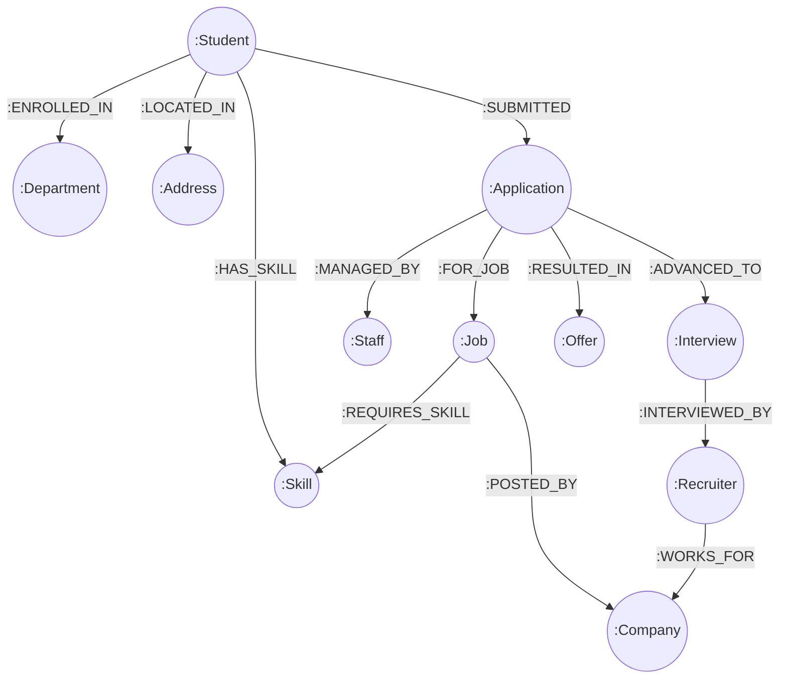

# Campus Placement Portal (Enterprise Edition)
**Course:** BACSE202 — Database Systems  
**Authors:** Shashwat Siddhant & Arnav Semwal  
**Repository:** [ArnavSemwal/PlacementPortalalt](https://github.com/ArnavSemwal/PlacementPortalalt)

---

## Project Overview

The **Campus Placement Portal** is an end-to-end institutional database system designed to streamline, track, and optimize university recruitment drives. Built across three academic milestones:

1. **DA1 — Relational Modeling & Normalization:** Designed an Entity-Relationship (ER/EER) model with 15 entities normalized to BCNF to eliminate insertion, deletion, and update anomalies.
2. **DA2 — PostgreSQL Enterprise Implementation:** Production database implementation featuring ACID stored procedures, automated audit triggers, Row-Level Security (RLS) policies, B+ Tree indexes, and OLAP analytics (`CUBE`/`ROLLUP`).
3. **DA3 — Modern Database Extension (Neo4j Graph Database):** Extension into a Property Graph Data Model leveraging **Index-Free Adjacency** for instant skill-matching, graph set-difference skill-gap analysis, reverse recruiter candidate ranking, and collaborative peer recommendation using the Jaccard similarity index.

---

## Milestone Deliverables Summary

| Milestone | Database Paradigm | Primary Engine | Key Technologies & Concepts | Deliverables |
| :--- | :--- | :--- | :--- | :--- |
| **DA1** | Conceptual & Logical | ER Modeling | ER/EER Diagrams, Functional Dependencies, BCNF Normalization | `ER Diagram.pdf`, `prd_text.txt` |
| **DA2** | Relational / RDBMS | PostgreSQL 18 | Stored Procedures (`sp_apply_for_job`), Triggers, RLS Policies, Indexes | `interactive_demo.py`, `DA2_Implementation_Report.md` |
| **DA3** | Graph Database | Neo4j (Cypher) | Property Graph Model, Index-Free Adjacency, Jaccard Index, Skill-Gap Analysis | `neo4j_demo.py`, `neo4j_schema.cypher`, `neo4j_seed.cypher`, `neo4j_queries.cypher`, `DA3_Report.md` |

---

## DA3: Neo4j Graph Database Extension

### Why Neo4j for Campus Recruitment?
While relational systems excel at transactional integrity, matching candidate skills with company requirements is fundamentally a network traversal problem. In traditional SQL, finding multi-hop connections requires heavy multi-table Cartesian joins ($O(N \times M)$). In **Neo4j**, physical memory pointers store relationships directly (**Index-Free Adjacency**), executing multi-hop traversals in constant $O(1)$ time relative to overall graph size.

### Graph Architecture


### Technology-Specific Graph Capabilities (The 8 Advanced Queries)
1. **Instant Graph-Based Eligibility & Skill Match:** Traverses `(Student)-[:HAS_SKILL]->(Skill)<-[:REQUIRES_SKILL]-(Job)` to compute percentage compatibility and filter by CGPA.
2. **Skill Gap Analysis (Graph Set Difference):** Computes missing required skill nodes preventing a student from achieving 100% eligibility for a target dream role (e.g. Google SDE-I).
3. **Reverse Recruiter Candidate Discovery & Ranking:** Allows visiting recruiters to search eligible applicant pools sorted by verified skill intersection count.
4. **Collaborative Peer Skill Similarity (Jaccard Index on Graph):** Computes pairwise student similarity based on skill neighborhood overlap to recommend study circles and mock interview partners.
5. **End-to-End Application Lifecycle Graph Traversal:** Single-expression multi-hop path reconstruction from Student through Application, Job, Company, Interview, and Offer.
6. **Market Skill Demand vs. Supply Analytics:** Graph degree centrality aggregating institutional talent supply vs. visiting employer demand.
7. **High-Package Placement Archetype Mining:** Subgraph pattern mining discovering recurring competencies across students receiving offers $\ge ₹30$ LPA.
8. **Placement Bottleneck & Lag Detection:** Operational monitor identifying applications stalled in `Pending` or `Interviewing` states without scheduled interview events.

---

## How to Run the Applications

### 1. Running the DA3 Neo4j Graph Explorer
The DA3 application features a **Dual-Engine Architecture**:
- Connects automatically to a Live Neo4j instance if running (`bolt://localhost:7687` or Neo4j AuraDB).
- Automatically falls back to an internal **High-Fidelity Embedded Graph Engine** (Offline Mode) with zero external setup required!

```bash
python neo4j_demo.py
```

### 2. Running the DA2 PostgreSQL Interactive Application
```bash
python interactive_demo.py
```

---

## Repository File Structure

```text
PlacementPortalalt/
├── .gitignore                          # Standard Python & OS ignore rules
├── README.md                           # Master documentation and setup guide
│
├── [DA3 GRAPH DATABASE ARTIFACTS]
├── neo4j_demo.py                       # Interactive CLI Graph Explorer (Dual-Engine: Live Neo4j + Embedded)
├── neo4j_schema.cypher                 # Cypher DDL: Constraints and performance indexes
├── neo4j_seed.cypher                   # Cypher DML: Complete 15-entity benchmark graph dataset
├── neo4j_queries.cypher                # All 8 technology-specific graph queries with expected outputs
├── DA3_Report.md                       # Comprehensive DA3 technical report & submission guide
│
├── [DA2 RELATIONAL ARTIFACTS]
├── interactive_demo.py                 # PostgreSQL Enterprise Edition CLI (RLS, Triggers, SPs)
├── DA2_Implementation_Report.md        # Academic submission report for DA2 deliverables
├── campus_placement.db                 # SQLite legacy reference database
│
└── [DA1 MODELING ARTIFACTS]
    ├── Campus_Placement_Portal_PRD_v1.1.docx # Product Requirements Document
    ├── ER Diagram.pdf                  # Relational Entity-Relationship diagram
    └── prd_text.txt                    # Plain-text specification of project scope
```

---

## Authors & Academic Integrity
- **Shashwat Siddhant** — Registration No: 25BCE5227
- **Arnav Semwal** — Registration No: 25BCE5392
- **Course:** BACSE202 — Database Systems (Vellore Institute of Technology)